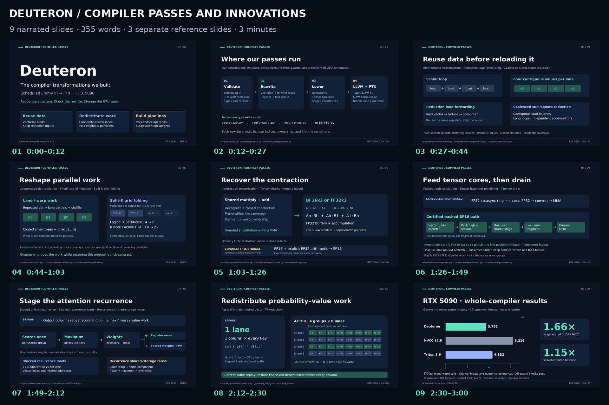

# Deuteron: compiler passes and innovations

Start with the [recording script](recording-script.pdf) or its [editable Word version](recording-script.docx), then preview the [nine-slide presentation](slides.pdf). The **355-word narration** ends at 2:55, followed by a five-second hold on the RTX 5090 results. The [full presentation guide](presentation-script.md) adds delivery cues, pronunciation, optional cuts, and claim boundaries.

The presentation now focuses on exact implemented transformations and their before/after behavior. The previous standalone PTX demonstration and reliability/test-count closing slide are removed. The [three reference slides](pass-reference.pdf) cover all **27 documented pass, analysis, policy, and lowering entries** and stay outside the three-minute edit.



| Asset | Use |
|---|---|
| [Recording script · PDF](recording-script.pdf) | Three printable pages with exact narration, timecodes, and brief cues. |
| [Recording script · Word](recording-script.docx) | Editable narration document. |
| [Full presentation guide](presentation-script.md) | Nine scenes, delivery directions, numerical and benchmark boundaries. |
| [Narration only](narration.txt) | Text for a teleprompter, without headings or stage directions. |
| [Main slides · PDF](slides.pdf) | Nine fixed-layout slides, matching the three-minute script. |
| [Main slides · PowerPoint](slides.pptx) | Editable text, diagrams, chart bars, and timed speaker notes. |
| [All pass entries · PDF](pass-reference.pdf) | Three optional reference slides, nine entries each. |
| [All pass entries · PowerPoint](pass-reference.pptx) | Editable reference deck with guard and source details in the notes. |
| [Source-linked pass reference](pass-reference.md) | Each entry's implementation, schematic before/after, and key guards. |
| [Engineering contributions](innovations.md) | Five concrete contributions, credited techniques, and implementation details. |
| [Pass inventory data](passes.json) | Exact names, order, descriptions, and source paths from the README inventory. |
| [1080p main-slide images](slides/) | Nine frames for the eventual video edit. |
| [1080p reference images](reference-slides/) | Three optional frames outside the narrated timeline. |
| [Recording and editing guide](recording-and-editing.md) | One-take recording setup and postproduction plan. |
| [Edit plan](edit-plan.json) | Scene timing, transitions, captions, music policy, and export settings. |
| [Claim sources](claims.json) | Source-backed hardware, pass, and measurement claims. |

The main story is: **scope → rewrite pipeline → reusable loads → lane and split-K work → tensorization → packed pipelines → staged attention → warp-distributed PV → RTX 5090 measurements**. The innovations are the recognizers, guards, ownership rewrites, and composed schedules implemented here. Tensorization, pipelining, attention techniques, and LLVM remain explicitly credited. Aggregate compiler results are not presented as per-pass speedups.

## Record and edit

Record one continuous landscape take with clear speech and no music. A talking-head video is enough; these slides will be inserted afterward. Pause and restart a whole sentence after a mistake, and keep the original file. The next edit will align the diagrams to the actual voice, add restrained transitions and quiet licensed or original instrumental music, then generate accurate captions. Clean and captioned 1080p exports are planned.

No narrated video, selected soundtrack, or final aligned caption file exists yet. The [previous real compiler capture](demo/README.md) remains supporting material in the source kit, outside the revised deck. PDF and PNG preserve the fixed rendering. Editable PowerPoint uses DejaVu Sans and Liberation Mono fonts.

## Rebuild

The documentation renderer is separate from the compiler package:

```sh
python -m pip install -r docs/video/requirements.txt
python docs/video/build_assets.py --output /tmp/deuteron-video-assets
```

The renderer reads the timed script, pass inventory, and recorded measurements; it never imports the compiler or initializes a GPU. Font paths are listed in `build_assets.py`. Omitting `--output` regenerates the assets in this directory. [assets-manifest.json](assets-manifest.json) records source and export hashes; [verification.json](verification.json) records content and rendering checks.

Compiler code, measured results, original inputs, and handoff 9 are unchanged from release `efb728d`. This revision changes presentation materials.
